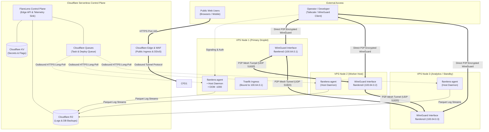
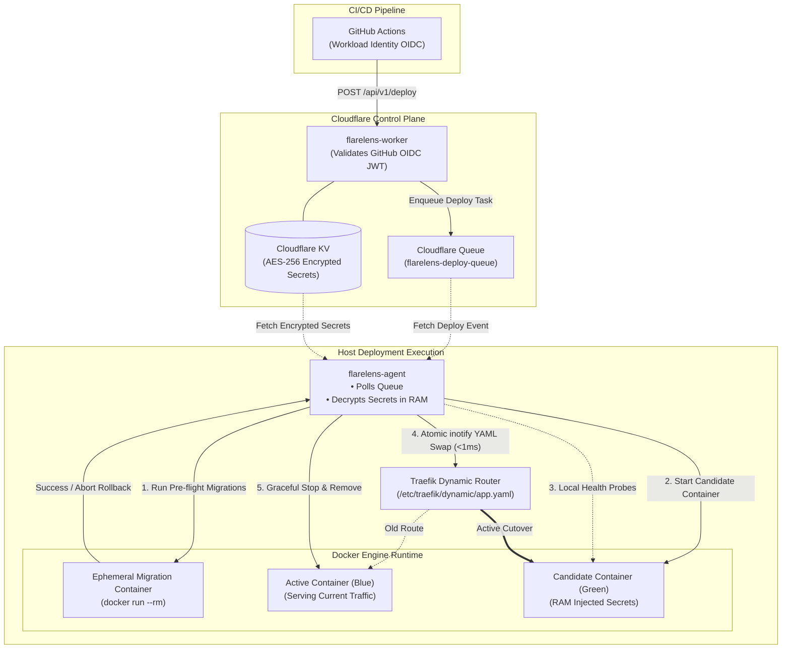

# flarelensd

> **The lightweight in-kernel host execution daemon for the FlareLens sovereign infrastructure control plane — in-kernel WireGuard mesh, atomic blue/green deployments, zero-plaintext secrets, and streaming telemetry in a single <25MB Go binary.**

[](https://github.com/antwig2/flarelensd/actions/workflows/ci.yml)
[](https://github.com/antwig2/flarelensd/actions/workflows/release.yml)
[](https://go.dev/)
[](LICENSE)
[](https://github.com/antwig2/flarelensd/releases)
[](https://github.com/antwig2/flarelens)

---

> [!NOTE]
> This repository contains **`flarelensd`**, the native host daemon.  
> For the serverless edge control plane and dashboard UI, see **[`flarelens`](https://github.com/antwig2/flarelens)** (deployable to Cloudflare Workers with 1 click).

---

## ⚡ Overview

**FlareLens** is the unified operational control plane for your infrastructure.

It unifies 4 major systems that previously required 4 separate tools:

```
┌────────────────────────────────────────────────────────────────────────┐
│                               FLARELENS                                │
│                                                                        │
│   1. OBSERVABILITY      ───  Live Logs, Metrics, Global Uptime Checks  │
│   2. ZERO-TRUST MESH    ───  P2P WireGuard Overlay (No Bastion/SSH)    │
│   3. GITOPS DEPLOYMENTS ───  Atomic Blue/Green Container Swaps (<1ms)  │
│   4. SECRETS & FLAGS    ───  Edge AES-256 Vault & Real-Time Flags      │
└────────────────────────────────────────────────────────────────────────┘
```

### The 4 Pillars of FlareLens:

#### 1. Observability (Replaces Grafana / Datadog / BetterStack)
- **Real-Time Live Tail**: Stream container and host logs in real time over SSE/WebSocket.
- **Serverless Edge Lakehouse**: Saves cold logs as compressed columnar Parquet files directly in Cloudflare R2 ($0 bandwidth egress fees).
- **Global Uptime Monitoring**: Cloudflare Worker pings your services every 60 seconds from 300+ cities worldwide and sends alerts to Telegram, Slack, WhatsApp, or Email.

#### 2. Zero-Trust Networking (Replaces Bastion Hosts / Tailscale / OpenVPN)
- **Serverless Edge Coordinator**: Coordinated serverlessly across 330+ Cloudflare edge PoPs (Workers + KV) with RFC 8628 Device Flow browser SSO (`@yourcompany.com`). **Zero coordinator VMs or SQLite databases to maintain.**
- **Pure P2P WireGuard Data Plane**: Encrypted point-to-point overlay (`100.64.0.0/10` CGNAT) running directly over UDP with **< 0.1ms kernel latency and $0 egress fees**.
- **Traefik Mesh Ingress**: Internal dashboards and container services bind directly to `100.64.0.1` (`flarelens0`), leaving zero public firewall ports open to port scanners.
- **Outbound-Only Signaling**: Eliminates open inbound SSH ports (port 22) to the public internet; port 22 is strictly bound to the private WireGuard mesh.

#### 3. GitOps & Zero-Downtime Deployments (Replaces Portainer / Jenkins / ArgoCD)
- **Atomic Blue/Green Rollouts**: Deploys the new container (Green), verifies its health on localhost, and performs an atomic inotify swap on Traefik routing in **< 1 millisecond** (zero dropped TCP connections).
- **Isolated Migration Runner**: Executes database schema migrations in an ephemeral container with auto-rollback before live traffic hits the new app version.

#### 4. Secrets Vault & Feature Flags (Replaces HashiCorp Vault / LaunchDarkly)
- **Encrypted Secrets Vault (AES-256-GCM)**: All your production secrets live encrypted at the Cloudflare edge.
- **RAM-Only Injection**: Secrets and cryptographic PEM keys are injected directly into container memory (`-e KEY=VAL`), leaving zero plaintext `.env` files on host hard drives.
- **Edge Feature Flags**: Evaluate toggle flags locally in **< 1 microsecond** with instant propagation from the dashboard.

> **In One Sentence:**  
> **FlareLens is Observability + Zero-Trust Networking + Continuous Deployment + Secrets Management, managed from a single serverless Cloudflare dashboard.**

---

### Fleet Overview

```
┌────────────────────────────────────────────────────────────────────────┐
│                   CLOUDFLARE EDGE CONTROL PLANE                        │
│               https://<your-worker-subdomain>.workers.dev              │
│                                                                        │
│   Single Dashboard for Logs, Metrics, Health, Alerts, Secrets & Flags │
└──────────────────────────────────┬─────────────────────────────────────┘
                                   │ Metadata & Signaling Only (TLS / WS)
       ┌───────────────────────────┼───────────────────────────┐
       ▼                           ▼                           ▼
┌───────────────────────┐ ┌───────────────────────┐ ┌───────────────────────┐
│   BARE-METAL / VM     │ │    CONTAINER HOST     │ │ DEVELOPER WORKSTATION │
│   (Zero Containers)   │ │   (Docker / Podman)   │ │  (Windows / macOS)    │
├───────────────────────┤ ├───────────────────────┤ ├───────────────────────┤
│ • Native Systemd apps │ │ • Blue/Green rollouts │ │ • P2P WireGuard mesh  │
│ • Host PostgreSQL     │ │ • Traefik atomic swap │ │ • Secure admin access │
│ • Kernel OOM (-1000)  │ │ • Container telemetry │ │ • Secrets injection   │
│ • OS reboot detection │ │ • In-memory secrets   │ │ • Zero open ports     │
└───────────────────────┘ └───────────────────────┘ └───────────────────────┘
```

### Fleet Mesh Architecture



---

### GitOps Blue/Green Zero-Downtime Pipeline



---

## 🔒 Architecture: Control Plane vs. Data Plane

A foundational design principle of FlareLens is the strict physical separation between the **Control Plane** and the **Data Plane**:

```
┌────────────────────────────────────────────────────────────────────────┐
│                   CONTROL PLANE (Cloudflare Edge)                      │
│                  "The Orchestrator, Not the Router"                    │
│                                                                        │
│   • Coordinates WireGuard peer discovery (Public Keys & Endpoints in KV│
│   • Enforces Zero-Trust Admin Identity (Cloudflare Access SSO / OTP)  │
│   • Stores Cold Parquet Logs & DB Backups (Cloudflare R2 - $0 Egress)  │
│   • Runs Serverless across 300+ cities (Zero master servers to patch)  │
└──────────────────────────────────┬─────────────────────────────────────┘
                                   │ Metadata & Signaling Only (KB/sec)
                                   ▼
┌────────────────────────────────────────────────────────────────────────┐
│                      DATA PLANE (WireGuard Mesh)                       │
│                        "Direct, Private, P2P"                          │
│                                                                        │
│    [ Node 1 (AWS) ] ◄═════════ Direct Encrypted ════════► [ Node 2 ]   │
│                       UDP P2P (10.42.0.0/16)                           │
│                                                                        │
│    ❌ NEVER touches Cloudflare data centers.                            │
│    ❌ Zero packet inspection or throttling by third parties.            │
│    ✅ Full LAN line-speed (10Gbps+ direct).                             │
│    ✅ End-to-end encrypted with local Curve25519 keys (RFC 7748).      │
└────────────────────────────────────────────────────────────────────────┘
```

### Why Cloudflare for the Control Plane?
Traditional platforms require provisioning and maintaining expensive central master servers (Kubernetes Control Plane nodes, HashiCorp Consul clusters, or Jenkins controllers) with open public IP ports. 

FlareLens eliminates the master server by leveraging Cloudflare's serverless edge primitives:
- **Cloudflare Workers**: High-performance, sub-10ms global edge API.
- **Cloudflare Access**: Enterprise Zero-Trust identity (Google, GitHub, Microsoft 365, or Email One-Time PIN) protecting the dashboard without opening public firewall ports.
- **Cloudflare KV**: Ephemeral signaling and peer coordination registry.
- **Cloudflare R2**: Columnar Parquet log lakehouse and database backup storage with **zero bandwidth egress fees**.

### Why WireGuard for the Data Plane?
Private inter-server communications, database replication, internal microservice calls, and operator SSH sessions **never touch Cloudflare**. They travel **directly peer-to-peer (P2P)** between your machines over an encrypted WireGuard UDP overlay (`10.42.0.0/16`), delivering full line-speed and absolute privacy.

---

## ✨ Core Superpowers

### 🌐 1. Serverless Edge-Native WireGuard Mesh (P2P)
- **Serverless Cloudflare Edge Coordinator**: Replaces centralized Headscale VMs with a global serverless coordinator on Cloudflare Workers + KV (`control.yourcompany.com`). Zero coordinator VMs and zero SQLite databases to manage.
- **Browser SSO Device Flow (RFC 8628)**: Users run `sudo flarelens-agent login` and authenticate via Cloudflare Access Zero Trust (`@yourcompany.com`) in their web browser.
- **Pure P2P Kernel Data Plane**: Traffic between servers and laptops flows directly peer-to-peer at line-rate Linux kernel speed (`flarelens0` via ChaCha20-Poly1305) with zero proxy hops.
- **Traefik Mesh Integration**: Workloads and admin dashboards listen exclusively on `100.64.0.1`, keeping public firewall ports completely closed to attackers.
- **Pure Go Cryptography**: Keypairs generated in-memory using `golang.org/x/crypto/curve25519` with RFC 7748 key clamping (`priv[0] &= 248`, `priv[31] = (priv[31] & 127) | 64`).
- **Zero Inbound WAN Ports**: Traverses NATs and corporate firewalls without opening host SSH ports (port 22) to the public internet; administrative SSH is locked strictly to the private mesh.

### 🔄 2. Blue/Green Zero-Downtime GitOps
- **Atomic Inotify Route Swapping**: Traefik routing rules are updated via atomic file renames (`os.Rename(tmp, final)` to `/etc/traefik/dynamic/service.yaml`). This prevents `inotify` from reading incomplete YAML during rollouts, cutting over traffic in **< 1 millisecond with zero dropped TCP packets**.
- **Canary & Health Probing**: Automatically runs HTTP readiness checks on candidate containers before traffic cutover.
- **Isolated Migration Runner**: Executes database migrations inside an ephemeral container (`docker run --rm`) on a private network with injected secrets.
- **Automated Rollback**: If candidate probes fail or migrations abort, the active container continues serving traffic with **zero downtime**.

### 🚩 3. Edge-Synchronized Feature Flags
- **Zero-Latency In-Memory Evaluation**: The Go agent maintains a local, thread-safe cache (`Store` with `sync.RWMutex`). Application flag lookups complete in **< 1 microsecond with 0 network hops**.
- **Real-Time Edge Sync**: Toggling a flag on the dashboard propagates updates via Cloudflare Edge KV & fast outbound polling/SSE streams.
- **Percentage Rollouts**: Supports deterministic rollout percentages (`rollout_pct: 0-100`) and environment scoping (`production`, `staging`, `infra`).

### 📊 4. Parquet Log Lakehouse & Live Stream
- **Dual-Tier Ingestion**: Ingests logs from systemd journald, Docker socket, syslog, Vector, or application SDKs via `POST /api/v1/ingest`.
- **Sub-Second Live Tail**: Real-time in-memory ring buffer streams live events to the web UI via Server-Sent Events (`/api/v1/live/sse`).
- **Columnar R2 Storage**: Automatically compacts log streams into compressed Apache Parquet files in Cloudflare R2, enabling SQL queries with **zero egress costs**.
- **Resilient WAL**: Local Write-Ahead Log buffers data to disk during network blips, guaranteeing zero log loss.

### 🔐 5. Zero-Trust Secrets Vault
- **AES-GCM-256 Authenticated Encryption**: Secrets are stored encrypted in Cloudflare KV.
- **In-Memory Injection**: Secrets are injected directly into container environment variables at launch time (`-e KEY=VAL`). They are **never written as cleartext `.env` files to the host hard drive**.

### 💾 6. Zero-Disk Streaming Database Backups
- **Memory-Piped `pg_dump`**: Streams compressed database backups directly into Cloudflare R2 via Go's `io.Pipe` and multipart S3 uploads.
- **Prevents Node Crashes**: Eliminates temporary 20GB `.sql` files on `/tmp`, preventing disk-full failures during deployments.
- **Host-Native & Container Support**: Works with both containerized PostgreSQL and host-native PostgreSQL installs.

### 🛡️ 7. Host Kernel OOM Governance & System Health
- **Self-Preservation**: Automatically sets `/proc/self/oom_score_adj = -1000` at startup on Linux so the host kernel never kills the FlareLens daemon under heavy load.
- **Workload Score Ladder**: Proactively prioritizes container survival (`-900` for databases, `-800` for caches, `+500` for background workers).
- **OS Kernel Patching & Reboot Detection**: Tracks `/var/run/reboot-required` on Linux and `RebootPending` registry keys on Windows.

---

## 🚀 Getting Started

Deploying FlareLens consists of two straightforward steps:
1. **Deploy your Control Plane**: Run the serverless Worker on **your own Cloudflare account**.
2. **Install the Agent on your Nodes**: Download the agent binary directly from **GitHub Releases** and point it to **your deployed Worker URL**.

---

### Step 1: Deploy Your Control Plane (Cloudflare Worker)

FlareLens uses Cloudflare Workers, KV, and R2 as a 100% serverless, zero-maintenance control plane. You deploy this into **your own Cloudflare account** for complete data ownership and zero SaaS markup.

```bash
# 1. Clone the repository
git clone https://github.com/antwig2/flarelens.git
cd flarelens/flarelens-worker

# 2. Install dependencies
npm install

# 3. Create required Cloudflare KV namespace and R2 bucket
npx wrangler kv namespace create FLEET_KV
npx wrangler r2 bucket create flarelens-logs-cold

# Ensure the KV ID returned above is set in wrangler.toml under [[kv_namespaces]]

# 4. Set your dashboard password and ingest token
npx wrangler secret put DASHBOARD_PASSWORD
npx wrangler secret put INGEST_SECRET

# 5. Deploy to your Cloudflare account
npx wrangler deploy
```

Once deployed, Cloudflare will output your unique live endpoint:
```text
https://flarelens.<your-subdomain>.workers.dev
```
*(You can also attach a custom domain in the Cloudflare dashboard, e.g. `https://control.yourdomain.com`)*.

> ⚠️ **Important:** This deployed URL is **your control plane endpoint**. You will provide this URL when configuring and running your FlareLens agents. Never use someone else's control plane URL.

---

### Step 2: Install FlareLens Agent on Your Nodes

Once your control plane is running, install `flarelens-agent` on your servers, VMs, or developer workstations.

#### Option A: Download Pre-Built Binaries from GitHub Releases (Recommended)

Standalone, statically compiled release binaries are hosted directly on **[GitHub Releases](https://github.com/antwig2/flarelens/releases)**:

| OS | Architecture | Binary Asset | Format |
| :--- | :--- | :--- | :--- |
| **Linux** | x86_64 (`amd64`) | `flarelens-agent-linux-amd64` | `.tar.gz` |
| **Linux** | ARM64 (`arm64`) | `flarelens-agent-linux-arm64` | `.tar.gz` |
| **Windows** | x86_64 (`amd64`) | `flarelens-agent-windows-amd64.exe` | `.zip` |
| **macOS** | Apple Silicon (`arm64`) | `flarelens-agent-darwin-arm64` | `.tar.gz` |
| **macOS** | Intel (`amd64`) | `flarelens-agent-darwin-amd64` | `.tar.gz` |

```bash
# Example: Download latest Linux amd64 binary directly from GitHub
curl -L -o /usr/local/bin/flarelens-agent \
  https://github.com/antwig2/flarelens/releases/latest/download/flarelens-agent-linux-amd64
chmod +x /usr/local/bin/flarelens-agent

# Run agent pointing to YOUR deployed Cloudflare Worker URL
flarelens-agent \
  --control-url "https://<your-worker-subdomain>.workers.dev" \
  --enroll-token "<YOUR_INGEST_SECRET>"
```

#### Option B: One-Line Installer (Served by Your Deployed Worker)

Your deployed worker serves ready-to-use bootstrap installers for your fleet:

**Linux:**
```bash
curl -fsSL https://<your-worker-subdomain>.workers.dev/install.sh | sudo bash -s -- \
  --control "https://<your-worker-subdomain>.workers.dev" \
  --token "<YOUR_INGEST_SECRET>"
```

**Windows (Run PowerShell as Administrator):**
```powershell
iwr -useb https://<your-worker-subdomain>.workers.dev/install.ps1 | iex
```

---

## ⚙️ Configuration Reference

Configuration is loaded dynamically with the following precedence:
1. **CLI Flags** (`--config`, `--node-id`, `--control-url`)
2. **Environment Variables** (`FLARELENS_NODE_ID`, `FLARELENS_CONTROL_URL`, `FLARELENS_ENROLL_TOKEN`)
3. **YAML Configuration** (`/etc/flarelens/agent.yaml` on Linux, `$ProgramData\FlareLens\agent.yaml` on Windows)

### Sample `/etc/flarelens/agent.yaml`

```yaml
identity:
  node_id: "node-fra-01"
  hostname: "app-prod-1"
  provider: "bare-metal"
  region: "fra1"
  tags: ["app", "prod"]

control_plane:
  # Point to YOUR Cloudflare Worker URL
  endpoint: "https://<your-worker-subdomain>.workers.dev"
  enroll_token: "${FLARELENS_ENROLL_TOKEN}"
  heartbeat_interval: 15s

mesh:
  enabled: true
  listen_port: 51820
  interface_name: "flarelens0"
  overlay_ip: "100.64.0.1"
  subnet: "100.64.0.0/10"

telemetry:
  log_level: "info"
  metrics_interval: 10s

database:
  mode: "host_native" # Or "container" for Docker PostgreSQL
  host: "127.0.0.1"
  port: 5432
  backup:
    enabled: true
    pre_deploy_snapshot: true
```

---

## 🛠️ CLI Usage

```bash
# Print agent version and build information
flarelens-agent --version

# Run daemon with explicit configuration file
flarelens-agent --config /etc/flarelens/agent.yaml

# Run in development mode with debug logging
flarelens-agent --dev --log-level debug

# Connect to YOUR deployed control plane and specify WireGuard mesh port
flarelens-agent --control-url https://<your-worker-subdomain>.workers.dev --mesh-port 51820
```

---

## 🏗️ Development & Building

### Prerequisites

- Go 1.22 or later
- Docker (optional, for Blue/Green container tests)

```bash
# Clone repository
git clone https://github.com/antwig2/flarelens.git
cd flarelens

# Run test suite
go test -v ./...

# Build binary locally
go build -ldflags="-s -w" -o bin/flarelens-agent ./cmd/agent

# Verify GoReleaser configuration
goreleaser check
```

---

## 📄 License

Licensed under the [Apache License, Version 2.0](LICENSE).  
Copyright &copy; 2026 FlareLens Authors.
